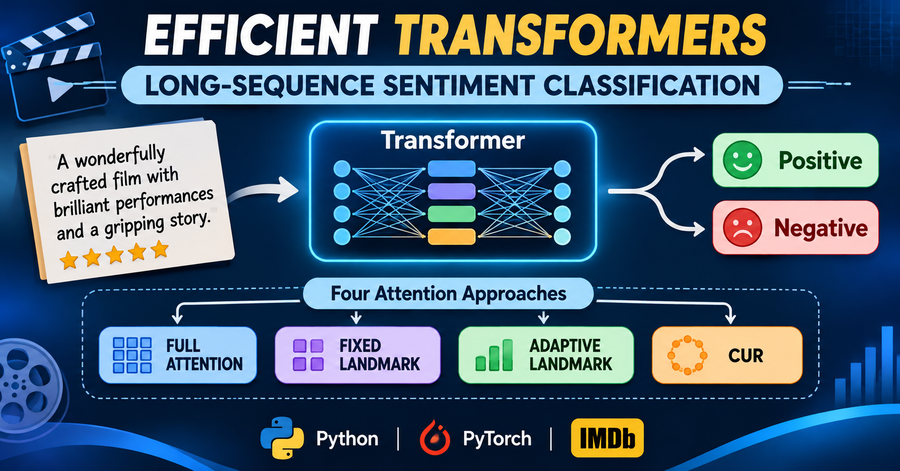

# Efficient Transformers for Long-Sequence Sentiment Classification

### A Comparative Study of Adaptive CUR-Inspired Landmark Attention and Standard Self-Attention on IMDb

**Exploring whether efficient attention mechanisms can reduce computation while preserving sentiment-classification performance.**

---

## 📌 Project Overview

Standard Transformer self-attention compares every position in a sequence with every other position. For a sequence of length \(n\), this produces an (n x n) attention-score matrix, resulting in quadratic computational complexity of \(O(n^2)\).

This project investigates efficient alternatives for processing long byte-level IMDb movie reviews.

Four Transformer encoder variants are implemented using the same architecture and training configuration. They differ only in their attention mechanisms:

1. **Full Self-Attention:** Every valid byte position attends to every other valid position.
2. **Fixed Landmark Attention:** Each review is represented using up to 64 segment-mean landmarks.
3. **Adaptive Landmark Attention:** The number of landmarks varies according to review length, between 16 and 64.
4. **CUR Attention:** A paper-style CUR approximation reconstructs attention using selected rows, columns, and an iterative pseudo-inverse.

The study is inspired by the research paper *Drop-in efficient self-attention approximation method* (François et al., 2025).

It explores the paper's suggestion of using a variable number of selected indices for different sequences.

## 🎯 Objectives

- Prepare IMDb reviews as byte-level sequences with a maximum length of 4,000 bytes.
- Establish a standard full-attention Transformer baseline.
- Implement fixed and length-adaptive landmark attention.
- Implement paper-style CUR attention using an iterative pseudo-inverse.
- Compare classification performance and computational efficiency under a shared encoder and training setup.
- Investigate whether adaptive landmark selection can maintain accuracy with fewer representatives.

## 🗂️ Dataset & Preprocessing

**Dataset:** IMDb Large Movie Review Dataset  
**Source:** [Hugging Face - Stanford IMDb](https://huggingface.co/datasets/stanfordnlp/imdb)

### Dataset Information

| Item | Description |
|---|---|
| Task | Binary sentiment classification |
| Labels | Negative (0), Positive (1) |
| Original training reviews | 25,000 |
| Training split used | 22,500 |
| Validation split | 2,500 |
| Test reviews | 25,000 |
| Maximum sequence length | 4,000 bytes |

### Preprocessing Steps

1. Replace HTML line-break tags (` `) with spaces.
2. Convert reviews to lowercase.
3. Encode text into UTF-8 byte sequences.
4. For reviews longer than 4,000 bytes, retain the first 2,000 and last 2,000 bytes.
5. Pad shorter sequences.
6. Reserve token ID `0` for padding.

## 🧠 Model Design

All four model variants share the same Transformer encoder architecture. Only the attention mechanism changes.

### Shared Architecture

| Component | Configuration |
|---|---|
| Byte embedding dimension | 64 |
| Convolution stem | 1-D convolution |
| Kernel size | 5 |
| Activation | GELU |
| Residual connection | Yes |
| Transformer encoder layers | 2 |
| Attention heads | 2 |
| Feed-forward dimension | 128 |
| Dropout | 0.1 |
| Classification pooling | Masked mean and max pooling |
| Output layer | Two-class linear layer |
| Trainable parameters | 104,514 per model |

### Attention Variants

| Variant | Attention Strategy | Landmark Budget |
|---|---|---|
| Full | Standard full self-attention | All valid positions |
| Fixed Landmark | Segment-mean landmarks | 64 |
| Adaptive Landmark | Length-based segment-mean landmarks | 16–64 |
| CUR | CUR-style reconstruction with pseudo-inverse | 64 |

### Adaptive Landmark Calculation

The adaptive landmark mechanism determines the number of landmarks based on the valid review length \(L\).

The landmark budget is defined as:

  

This allows shorter reviews to use fewer landmarks while longer reviews can use more, subject to the minimum and maximum budget.

Observed average: 22.7 landmarks per review on the test set.

## ⚙️ Training Configuration

All four models use a shared training configuration to ensure a fair comparison.

| Setting | Value |
|---|---|
| Framework | PyTorch 2.11.0 |
| Hardware | Tesla T4 GPU (Google Colab) |
| Optimizer | AdamW |
| Learning rate | 5e-4 |
| Weight decay | 0.01 |
| Batch size | 16 |
| Maximum epochs | 15 |
| Learning-rate schedule | 6% warmup + cosine decay |
| Loss function | Cross-entropy with 0.05 label smoothing |
| Gradient clipping | 1.0 |
| Early stopping | 4 epochs without validation improvement |
| Random seed | 42 |
| Precision | Mixed precision (FP16) |
| CUR pseudo-inverse precision | FP32 |

---

## 📊 Experimental Results

The four attention mechanisms were evaluated on the IMDb test dataset using the same classification task.

### 1. Test Accuracy

| Attention Mechanism | Test Accuracy |
|---|---:|
| Full Self-Attention | **84.01%** |
| Fixed Landmark | **83.80%** |
| Adaptive Landmark | **84.06%** |
| CUR Attention | **84.31%** |

**Observation:**

All four attention mechanisms achieved comparable classification accuracy.

CUR attention recorded the highest accuracy at 84.31%, while adaptive landmark attention achieved 84.06%, slightly higher than the full-attention baseline.

The maximum difference between the highest and lowest accuracy was approximately 0.51 percentage points.

However, each model was trained only once, so these results do not establish a statistically reliable ranking.

### 2. Computational Efficiency

| Model | Training Time / Epoch | Training Speed-up | Inference / Batch | Inference Speed-up | Peak GPU Memory |
|---|---:|---:|---:|---:|---:|
| Full | 190.53 s | 1.00× | 34.02 ms | 1.00× | 0.445 GB |
| Fixed Landmark | 42.86 s | 4.44× | 10.73 ms | 3.17× | 0.401 GB |
| Adaptive Landmark | 42.73 s | 4.46× | 10.76 ms | 3.16× | 0.403 GB |
| CUR | 82.48 s | 2.31× | 20.84 ms | 1.63× | 0.753 GB |

### 3. Key Observations

- **Fixed Landmark Attention:** Achieved 83.80% accuracy while training approximately 4.44 times faster than full self-attention.
- **Adaptive Landmark Attention:** Achieved 84.06% accuracy with approximately 4.46 times faster training.
- **CUR Attention:** Achieved the highest test accuracy of 84.31%, but its computational cost was higher than both landmark-based approaches.
- **Inference Efficiency:** Fixed and adaptive landmark attention achieved approximately 3.2 times faster inference than full self-attention.
- **Memory Usage:** Peak GPU memory was not reduced consistently. CUR attention consumed more memory than the full-attention baseline.

### 4. Adaptive Landmark Efficiency

The adaptive landmark mechanism used an average of 22.7 landmarks per review.

For an analytical comparison of landmark-to-token attention scores against full self-attention, the ratio is:

Attention Score Ratio

Using an average sequence length of approximately 4,000 bytes and 22.7 landmarks:

This represents approximately 0.57% of the full-attention score count under this analytical comparison.

**Important:** This is an analytical comparison of attention-score counts, not a measurement of actual GPU memory consumption or end-to-end computational cost.

Although adaptive attention reduced the average landmark budget, the batched implementation still used 64 landmark slots with masking. Therefore, it did not provide additional measured wall-clock savings over fixed landmark attention.

---

## 🔍 Conclusion

This project investigates whether efficient attention mechanisms can preserve Transformer classification performance while reducing computational cost on long byte-level sequences.

The experimental results suggest that landmark-based attention can achieve classification accuracy comparable to standard full self-attention while significantly reducing training and inference time.

Among the four implementations:

- Full self-attention provides the standard Transformer baseline.
- Fixed landmark attention provides a simpler and computationally efficient alternative.
- Adaptive landmark attention maintains comparable accuracy with fewer landmarks on average.
- CUR attention achieves the highest observed accuracy but introduces additional computational and memory overhead.

**Overall, fixed and adaptive landmark attention provided the strongest balance between classification accuracy and computational efficiency in this experiment.**

These findings are specific to the implemented architecture, IMDb dataset, and experimental configuration. Further experiments are necessary to establish whether the same benefits generalize to other datasets and longer sequences.

## ⚠️ Limitations

- Each model was trained only once using random seed 42.
- Multiple preprocessing, architecture, and training improvements were introduced together, so their individual effects were not isolated.
- Adaptive landmark selection is based on sequence length rather than learned content importance.
- The batched adaptive implementation uses 64 landmark slots with masking, limiting the practical wall-clock benefit of its reduced average landmark count.
- Memory reduction was not achieved consistently.
- The study uses a relatively small model and a single binary IMDb classification task.
- Other Long Range Arena tasks and longer input sequences were not tested.
- The original research paper and this project use different experimental configurations, so their results are not directly comparable.

## 🚀 Future Work

- Repeat experiments using multiple random seeds.
- Perform landmark-count and component ablation studies.
- Explore content-aware and learned landmark selection.
- Bucket reviews by sequence length to better realize adaptive-computation savings.
- Test larger Transformer encoders and longer sequences.
- Implement fused landmark and CUR attention mechanisms.
- Evaluate the approaches on additional sequence-classification tasks.
- Investigate GPU memory optimization and practical scalability.

## 🧰 Technologies Used

| Technology | Purpose |
|---|---|
| Python | Programming language |
| PyTorch | Transformer implementation and model training |
| Hugging Face Datasets | IMDb dataset loading |
| NumPy | Numerical computations |
| CUDA | GPU acceleration |
| Google Colab | Model training and experimentation |
| IMDb | Sentiment classification dataset |

## ▶️ Running the Project

The main notebook containing the end-to-end implementation is:

`Text_Baseline.ipynb`

### Prerequisites

- Python 3.13
- PyTorch 2.11.0
- Hugging Face Datasets
- NumPy
- CUDA-enabled GPU (recommended)

### Execution Steps

1. Clone or download this repository.
2. Open `Text_Baseline.ipynb` using Google Colab or a compatible Jupyter environment.
3. Select a CUDA-enabled GPU runtime.
4. Install or enable the dependencies used by the notebook.
5. Execute the notebook cells sequentially.

The notebook performs the following operations:

1. Loads the IMDb dataset.
2. Preprocesses reviews into byte-level sequences.
3. Constructs the shared Transformer encoder.
4. Implements the four attention mechanisms.
5. Trains the individual model variants.
6. Evaluates test accuracy.
7. Measures training time, inference time, and GPU memory usage.
8. Compares the experimental results.

**Note:** The notebook and its exact dependency requirements should be included in the repository. Update the installation instructions if additional setup steps are required by the committed notebook.

## 📚 Reference

François, D., Saillot, M., Klein, J., Bissyandé, T. F., & Skupin, A. (2025).

*Drop-in efficient self-attention approximation method.*

Machine Learning, 114, 139.

https://doi.org/10.1007/s10994-025-06768-3

---

### Academic Project

**Built as an academic project in Transformer Models & Sequence Learning.**

*Learn · Experiment · Compare · Improve*

Text_Baseline_Improvement-project/
│
├── images/
│   └── transformer-thumbnail.png
│
├── README.md
│
└── Other project files...
